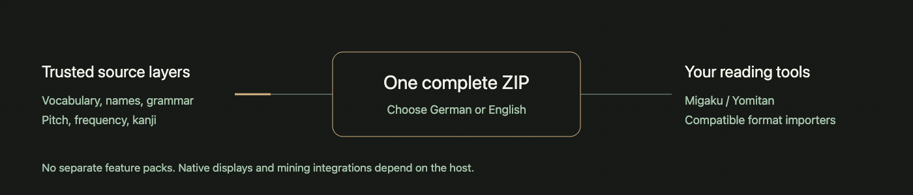
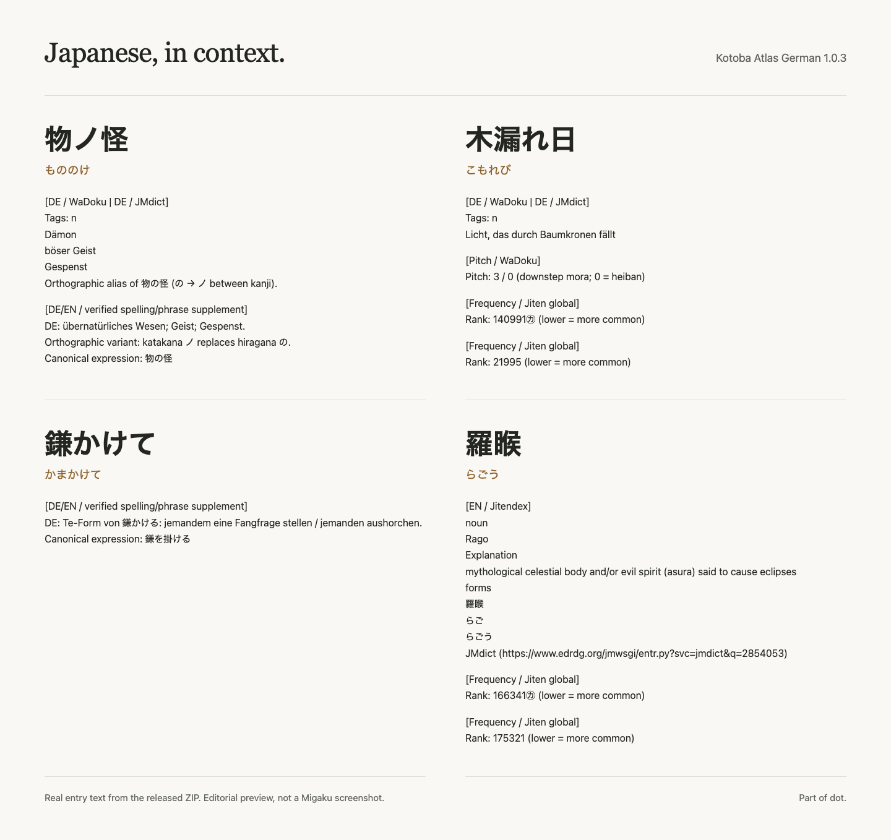

<p align="center"></p>

<p align="center">
<a href="https://github.com/Somamill/kotoba-atlas/releases"></a>
<a href="https://www.reddit.com/user/dot-app/"></a>
</p>
<p align="center">
<a href="#download"><strong>Choose a download</strong></a> &nbsp; / &nbsp;
<a href="#full-feature-set">Features</a> &nbsp; / &nbsp;
<a href="#install">Install</a> &nbsp; / &nbsp;
<a href="docs/compatibility.md">Compatibility</a> &nbsp; / &nbsp;
<a href="docs/releases/1.0.3/">Test evidence</a> &nbsp; / &nbsp;
  <a href="https://www.reddit.com/user/dot-app/">Reddit</a>
</p>

**Your Japanese lookup library, in one file.** Everyday vocabulary, source-covered slang, phrases, names, grammar, folklore and kanji—plus pitch and frequency references. Choose your definition language and bring the same complete ZIP to your compatible reading tools.

> **Corrected multilingual preview:** [Atlas 1.1.0 beta 2](https://github.com/Somamill/kotoba-atlas/releases/tag/atlas-v1.1.0-beta.2) introduces structured senses, canonical identities, ten definition families and one shared native core. [Coverage and verification](docs/releases/atlas-v1.1.0-beta.2.md). App-default migration is still in progress.
>
> Historical 1.0.3 and 1.0.4 beta files remain unchanged and can display formatting or cross-reference text as definitions, including ノリのいい ([#5](https://github.com/Somamill/kotoba-atlas/issues/5)). They are not the corrected schema-2 artifacts.

<a id="download"></a>

### New beta: choose the format your tool uses

| Use | Download | What to expect |
|---|---|---|
| Browser dictionary | [English ZIP](https://github.com/Somamill/kotoba-atlas/releases/download/atlas-v1.1.0-beta.2/Kotoba_Atlas_English_v1_1_0_beta_2.zip) · [German ZIP](https://github.com/Somamill/kotoba-atlas/releases/download/atlas-v1.1.0-beta.2/Kotoba_Atlas_German_v1_1_0_beta_2.zip) | One ZIP per definition language; German includes English fallback. Keep compressed. |
| Native app integration | [Consumer manifest](https://github.com/Somamill/kotoba-atlas/releases/download/atlas-v1.1.0-beta.2/consumer-manifest.json) | Shared core + English fallback + selected language packs; schema-2 reader required. |
| Coverage and provenance | [Release notes](docs/releases/atlas-v1.1.0-beta.2.md) · [Contract](docs/consumer-contract.md) | Japanese ↔ en/zh/es/ar/id/pt/fr/ja/ru/de. Source-specific partial coverage, with equivalents distinguished from definitions. |

The complete browser archives pass the pinned Yomitan parser and legacy Migaku importer; a representative IndexedDB fixture verifies reading lookup. A current live extension install remains unverified. Native reader/installer tests do not mean every app has adopted the new default yet.

Installation: [English](docs/install.en.md) · [Deutsch](docs/install.de.md) · [日本語](docs/install.ja.md).


## Historical stable download

| Definition language | Complete versioned ZIP | Lookup pairs | Download size |
|---|---|---:|---:|
| **German with English fallback** | **[Kotoba_Atlas_German_v1_0_3.zip](https://github.com/Somamill/kotoba-atlas/releases/download/atlas-v1.0.3/Kotoba_Atlas_German_v1_0_3.zip)** | 1,566,695 | 50.3 MB |
| **English** | **[Kotoba_Atlas_English_v1_0_3.zip](https://github.com/Somamill/kotoba-atlas/releases/download/atlas-v1.0.3/Kotoba_Atlas_English_v1_0_3.zip)** | 1,080,167 | 42.5 MB |

**One ZIP per definition language. No separate tool editions or feature packs.** German already includes English fallback; you do not need both. Keep the ZIP compressed for import. [Checksums](https://github.com/Somamill/kotoba-atlas/releases/download/atlas-v1.0.3/SHA256SUMS) · [Release notes](https://github.com/Somamill/kotoba-atlas/releases/tag/atlas-v1.0.3)

<picture>
<source media="(prefers-reduced-motion: reduce)" srcset="docs/media/one-file.svg">

</picture>

## Look inside



*Rendered from actual 1.0.3 release entries. This is an editorial content preview, not a screenshot of Migaku or Yomitan. Definition wording and source attribution are retained; labels are formatted for the preview.*

## Full feature set

| Feature | What you get in the complete ZIP |
|---|---|
| **Core vocabulary** | Jitendex, newer JMdict term/reading gaps and Wiktionary supplements. |
| **German definitions** | WaDoku and JMdict German meanings where the term/reading pair is covered; English fallback elsewhere. |
| **Slang and register** | Source-covered colloquial vocabulary, slang, register and usage labels. Coverage follows the included sources. |
| **Phrases and nuance** | Idioms, supplied usage notes and examples; reviewed phrase supplements. Examples are included where supplied, not for every entry. |
| **Grammar** | NINJAL grammar-pattern bank and source grammar references. |
| **Inflected forms** | Preserved verb/adjective rules for supporting deinflection engines; 14 upstream Yomitan regression cases checked. |
| **Spellings and aliases** | Explicit fixes such as 物ノ怪 and colloquial 鎌かけて; labeled の → ノ aliases between kanji. |
| **Names** | JMnedict names, ranked below ordinary vocabulary. |
| **Kanji** | 10,384 native kanji records with meanings and on/kun readings, plus readable references. |
| **Pitch and pronunciation notes** | WaDoku native pitch data and readable pitch/devoicing notes. |
| **Frequency** | Jiten global native frequency data and readable rank notes from multiple kinds of Japanese media. |
| **Folklore** | Attributed Japanese yōkai reference material. |
| **Native data + text fallback** | 1,006,753 native frequency/pitch records and 74 tags per edition. Readable references travel in the same ZIP. |
| **Import packaging** | Standard Yomichan v3 JSON banks in a Deflate ZIP; each data bank capped at 2 MiB; Base64 transfer-size guard. |
| **Updates and provenance** | Stable edition titles, versioned filenames, update manifests for supporting hosts, SHA-256 checksums and retained source licences. |


Counts are **term-and-reading pairs and record counts, not unique Japanese words**. Names, spellings and reference entries contribute to lookup totals. The chart compares independent record families; do not add them together. [Coverage details](docs/coverage.md)

## One file, clear compatibility

| Tool or capability | Status |
|---|---|
| **Migaku Early Access** | German installation and 物ノ怪 lookup confirmed by the user on 1.33.0-earlyaccess.2. Installed UI was not independently inspected. |
| **Yomitan** | Both full archives pass the pinned upstream importer/parser, schemas and deinflection checks. Full persistent browser installation remains untested. |
| **Other Yomichan-format importers** | Standard word banks plus native metadata/kanji banks. Supported banks and feature displays vary by importer. |
| **Pitch graphs, frequency sorting, kanji panels** | Native data is supplied; app support and settings determine presentation. Installed presentation is not fully verified. |
| **Anki mining** | Use your host's mining integration to save the relevant sense and encountered sentence. This is a dictionary, not an Anki deck. |
| **Audio, OCR, scanning and AI sentence analysis** | Provided by your app or service; not bundled in the dictionary. |
| **MDict, StarDict, Kobo or proprietary formats** | Require conversion; this ZIP is not a native export for those formats. |

No dictionary guarantees every Japanese expression or every contextual nuance. Kotoba Atlas combines complementary sources and documented fixes; interpretation and phrase selection still depend on the text and host. [Full compatibility matrix](docs/compatibility.md) · [Source licences](DATA-LICENSES.md) · [Community research](docs/research.md)

## Smaller transfer. Complete content.


Version 1.0.3 fixes the previous Chrome/Migaku oversized-message failure through lossless record grouping and stronger standard ZIP compression. **Every decoded 1.0.2 word, metadata, kanji and tag record survives, including duplicates.** Source notices remain byte-identical.

Both complete archives pass schemas, exact content-parity checks and the upstream Yomitan parser. **19 local tests pass.** Checksums match GitHub's uploaded assets. These verify packaging and content—not universal app behavior or lookup speed. GitHub Actions is disabled; cloud CI was not run. [Measurements](docs/performance.md) · [Transfer investigation](docs/transfer-limit.md)

## Install

1. Download **German** or **English** above. Do not unzip it.
2. **Migaku:** open dictionary settings and choose import from file. **Yomitan:** Settings → Dictionaries → Configure installed and enabled dictionaries → Import.
3. Enable the imported edition. Try **物ノ怪**, **羅睺** and **鎌かけて** with manual lookup, then test scanning in your normal reading tool.
4. Confirm the replacement works before removing an older dictionary. Allow working disk space for expanded data, temporary copies and the host database.

Keep your working dictionary until the replacement finishes. If an old import is stalled, cancel it before retrying. Use normal host controls for duplicate titles and replacement; do not delete your browser profile or learning database. [Upgrade guidance](docs/compatibility.md#upgrading)

## Historical 1.0.4 beta: lookup verification and dict.

**[Download 1.0.4 beta 1](https://github.com/Somamill/kotoba-atlas/releases/tag/atlas-v1.0.4-beta.1).** The frozen helper retrieves candidate entries for **98.40% (German)** and **95.78% (English)** of Japanese content tokens in a fresh seven-title sample. These are retrieval rates, not selected-sense accuracy. [Newest verification results](docs/accuracy.md)

The beta adds the optional Lookup Lab toolkit and checked native SQLite exports for **[dict.](https://github.com/Somamill/dict)**, the native offline Apple app. The complete import ZIPs retain every non-index member from 1.0.3. Importing a ZIP does not install the helper into Migaku/Yomitan. [Beta package guide](docs/releases/1.0.4-beta.1/)

## Build and verify

Python 3.11+ and **7-Zip 26.06** build both complete language editions. The output is a standard Deflate ZIP readable by supporting dictionary apps. Temporary sorting databases are cleaned automatically; high compression can take several minutes. Builds fail if the Base64 transfer budget would be exceeded. Inputs are pinned by hash. The changing Jiten resource is kept as an attributed, immutable source snapshot; users do not install it separately.

```sh
# Install 7-Zip 26.06 (macOS: brew install sevenzip)
python3 scripts/build.py
python3 -m pip install -r requirements-dev.txt
python3 -m unittest discover -s tests
python3 scripts/validate.py dist/Kotoba_Atlas_English_v1_0_3.zip
python3 scripts/validate.py dist/Kotoba_Atlas_German_v1_0_3.zip
python3 branding/dot/check.py
```

The release includes SHA-256 checksums and reports for both editions. [Source licences](DATA-LICENSES.md) · [Local-folder audit](docs/folder-audit.md) · [Release reports](docs/releases/1.0.3)

The old personal build remains local and can include commercial or unclear-licence material; it is not a public edition. Earlier `dict.` prototype tags remain in release history. **Kotoba Atlas starts at version 1.0.0.**

## Part of dot.

A quieter way to read, listen, and learn.

[read. — Books, articles, and highlights](https://github.com/Somamill/read) · [listen. — Find your next audiobook](https://github.com/Somamill/listen) · [Immersed — Japanese worth watching](https://github.com/Somamill/immersed)

Identity follows the [shared dot. brand kit](https://github.com/Somamill/dot-brand-kit). Project code is MIT-licensed; dictionary data and brand assets retain their own licences.

## Contact

Questions, ideas, or spotted a bug? [Email Max](mailto:max@miller-max.com). Feedback is always welcome.
