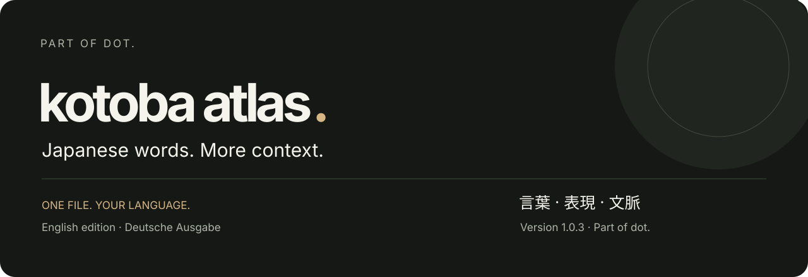

<p align="center"></p>

<p align="center">
  <a href="https://github.com/Somamill/kotoba-atlas/releases/latest"><strong>Kotoba Atlas 1.0.3</strong></a>
  &nbsp; · &nbsp; <a href="#install">Install</a>
  &nbsp; · &nbsp; <a href="docs/compatibility.md">Compatibility</a>
  &nbsp; · &nbsp; <a href="docs/research.md">Research</a>
</p>

**One complete dictionary file for your definition language.** Read Japanese with vocabulary, phrases, usage notes, names, kanji, grammar references, folklore, and pitch/frequency information in the same ZIP.

## Download one complete dictionary

| Japanese definitions | Download | Lookup pairs¹ |
|---|---|---:|
| **German, with English fallback** | **[Kotoba Atlas German · v1.0.3 ↓](https://github.com/Somamill/kotoba-atlas/releases/download/atlas-v1.0.3/Kotoba_Atlas_German_v1_0_3.zip)** | **1,566,695** |
| **English** | **[Kotoba Atlas English · v1.0.3 ↓](https://github.com/Somamill/kotoba-atlas/releases/download/atlas-v1.0.3/Kotoba_Atlas_English_v1_0_3.zip)** | **1,080,167** |

**One ZIP per definition language. Use the same file in Migaku, Yomitan or another compatible Yomichan-format importer.** There are no separate tool editions, feature packs or required extras. German already includes English fallback; you do not need the English edition alongside it.

Every file includes the complete word banks, readable pitch/frequency/kanji references and native metadata/kanji/tag banks. Supporting apps display the native features; word-only importers can use the reference text. Audio, scanning, pitch graphs and Anki mining require support from the app. **Migaku 1.33.0-earlyaccess.2 now progresses beyond preparation with this archive; full completion is awaiting user confirmation.**

¹ Counts are term-and-reading pairs, including names, spellings and reference entries, rather than distinct words. Sources retain their licences; coverage of every Japanese expression or nuance is not guaranteed.

### Clear names

`Kotoba_Atlas_German_v1_0_3.zip` = product + definition language + version **1.0.3**. The English filename follows the same pattern. Underscores avoid legacy Migaku filename/SQL restrictions. The established internal titles, **Kotoba Atlas — German** and **Kotoba Atlas — English**, stay stable so full-edition updates retain their identity.

## What is inside each file

| Layer | Included sources and handling |
|---|---|
| Vocabulary and slang | **Jitendex**, with newer **JMdict** filling missing term/reading pairs, plus **Wiktionary**; German edition adds **WaDoku** and **JMdict German** |
| Phrases and nuance | Source usage labels, notes and supplied examples; **NINJAL grammar-pattern bank**; reviewed phrase supplements |
| Names | **JMnedict**, ranked below ordinary vocabulary |
| Kanji | **KANJIDIC** meanings and on/kun readings |
| Folklore | Attributed Japanese yōkai reference text |
| Pronunciation | **WaDoku** native pitch data plus readable pitch/devoicing notes |
| Frequency | **Jiten global** native frequency data plus rank notes, built from multiple kinds of Japanese media |
| Written variants | Explicit aliases for forms such as **物ノ怪**; labeled の → ノ aliases between kanji |

Pitch, frequency and kanji are supplied as **native Yomichan banks and readable word notes in the same ZIP**. No audio, images, scripts or fonts are bundled. [Feature matrix →](docs/compatibility.md)

## Verified content and import paths

Every decoded word, native metadata, kanji and tag record from 1.0.2 is retained, including duplicate records. Similar records are grouped for stronger standard ZIP compression; bank ordering and compressed bytes change. Source notices and licences remain intact. German uses German meanings when available for a term/reading pair, with English fallback for gaps. Names rank below ordinary vocabulary; metadata alone never creates a fake definition. Each data bank stays within 2 MiB, although an importer may hold many banks in memory.

Both complete editions pass upstream schemas and edition checks. The complete archives pass the pinned upstream Yomitan parser and 14 deinflection cases. Earlier releases exercised the public legacy Migaku-to-SQLite path and representative Yomitan database fixtures; the new content-parity checks verify every decoded field is unchanged. [Release evidence →](docs/releases/1.0.3/) · [Measurements and limits →](docs/performance.md)

**These checks do not certify the installed current Migaku Early Access or Yomitan extension UI.** The supplied Chrome error identifies the 64 MiB message limit: v1.0.3 fits after Base64 encoding with 64 KiB reserved for message overhead. [Transfer-limit investigation →](docs/transfer-limit.md) Keep a working dictionary until the replacement imports successfully.

## Install

1. Download **German** or **English**. German already includes English fallback. Keep the ZIP compressed.
2. **Yomitan:** Settings → Dictionaries → Configure installed and enabled dictionaries → Import.
3. **Migaku:** use the dictionary settings' import-from-file action. Exact labels vary by version. Use the same complete ZIP. Its ordinary word banks carry readable references; apps with native-bank support can use those features. Current Early Access runtime compatibility remains unverified.
4. Enable the imported edition and try a manual lookup for **羅睺**, **物ノ怪**, and **鎌かけて**. Then test hover or selected-phrase lookup.

If the old **Dict Personal** import is still preparing, cancel that operation before starting a new one. Keep an already-installed dictionary until the replacement works. Use the host's normal replacement/removal controls if it rejects a duplicate title. If you installed a 1.0.1 edition whose name ends in `_Migaku`, install this complete edition through the normal importer, then disable/remove the older edition after success. Earlier full editions retain their update identity. Source update manifests are supplied for supporting hosts; actual update behavior depends on the host.

## Built around reading examples

| Encountered text | Handling |
|---|---|
| `羅睺` | English definitions and readings `らご` / `らごう` |
| `物ノ怪` | Exact alias for `物の怪` / `もののけ` |
| `鎌かけて` | Colloquial phrase entry linked to `鎌を掛ける` |
| `鎌かける` | Base form with the `v1` inflection rule |

Source verb/adjective rules are retained even where duplicate explanations are removed. Explicit phrase fixes do not generalize particle deletion to arbitrary Japanese. Different spellings/readings can remain separate results because merging them indiscriminately can erase distinctions.

For Anki mining, save the sentence you actually encountered and the relevant sense, rather than treating a dictionary's whole entry as one fact. This is a lookup resource, **not a million-card Anki deck**. [Community lessons and source notes →](docs/research.md)

## Build and verify

Python 3.11+ and **7-Zip 26.06** build both complete language editions. The output is a standard Deflate ZIP readable by supporting dictionary apps. Temporary sorting databases are cleaned automatically; high compression can take several minutes. Builds fail if the Base64 transfer budget would be exceeded. Inputs are pinned by hash. The changing Jiten resource is kept as an attributed, immutable source snapshot; users do not install it separately.

```sh
# Install 7-Zip 26.06 (macOS: brew install sevenzip)
python3 scripts/build.py
python3 -m pip install -r requirements-dev.txt
python3 -m unittest discover -s tests
python3 scripts/validate.py dist/Kotoba_Atlas_English_v1_0_3.zip
python3 scripts/validate.py dist/Kotoba_Atlas_German_v1_0_3.zip
python3 branding/dot/check.py
```

The release includes SHA-256 checksums and reports for both editions. [Source licences](DATA-LICENSES.md) · [Local-folder audit](docs/folder-audit.md) · [Release reports](docs/releases/1.0.3)

The old personal build remains local and can include commercial or unclear-licence material; it is not a public edition. Earlier `dict.` prototype tags remain in release history. **Kotoba Atlas starts at version 1.0.0.**

## Part of dot.

A quieter way to read, listen, and learn.

[read. — Books, articles, and highlights](https://github.com/Somamill/read) · [listen. — Find your next audiobook](https://github.com/Somamill/listen) · [Immersed — Japanese worth watching](https://github.com/Somamill/immersed)

Identity follows the [shared dot. brand kit](https://github.com/Somamill/dot-brand-kit). Project code is MIT-licensed; dictionary data and brand assets retain their own licences.
